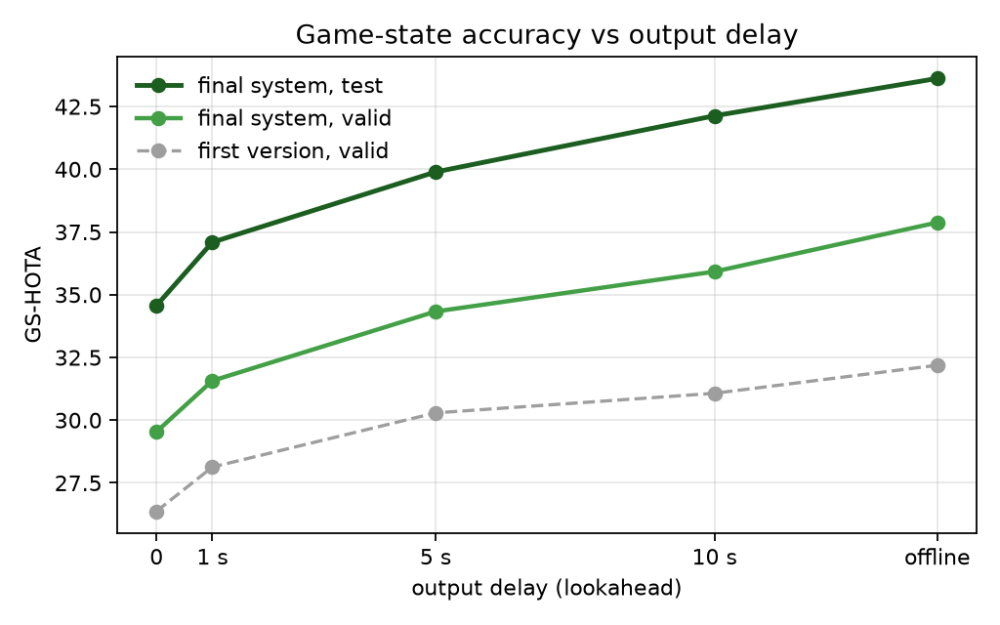

# Sideline: live game state reconstruction from a single broadcast feed

Broadcast soccer video in, a live top-down minimap out: every player's position on the
pitch, identity, team, role and jersey number, in real time on one GPU.

**The research question.** Published game state reconstruction (GSR) systems are offline:
they cluster teams over the whole clip, read jersey numbers anywhere in a track and paint
them back, and merge tracklets afterwards, and they report accuracy without speed. Sideline
makes every decision causal, evaluates the system as a live one, and measures how accuracy
depends on the output delay, meaning how long the system may wait before committing an
answer. The full write-up is in [`docs/REPORT.md`](docs/REPORT.md).

## Results

SoccerNet-GSR, official GS-HOTA. Test is the 49-clip public test split, with every setting
frozen from validation.

| Output delay | 0 (live) | 1 s | 5 s | 10 s | offline |
|---|---|---|---|---|---|
| **test (49 clips)** | **34.6** | **37.1** | **39.9** | **42.1** | **43.6** |
| valid (58 clips) | 29.5 | 31.6 | 34.3 | 35.9 | 37.9 |

- **Speed:** 32 FPS sustained on one H100 NVL with every stage running (TensorRT FP16
  detector and pose, asynchronous keyframe calibration), at 56 ms median and 64 ms p95
  processing latency.
- **What waiting buys:** jersey recognition gains 17 points from live to offline and team
  assignment 9. Pitch calibration doesn't depend on delay.
- **Where the gap is:** perfect jersey numbers alone would add 12.7 points live. Each real
  player is still split into about 2.85 tracks.



These are public-test numbers. The SoccerNet challenge leaderboard uses a hidden split,
where the offline winners score about 64, so the two aren't directly comparable. See
[`docs/REPORT.md`](docs/REPORT.md) for the ablations, the error budget and the negative
results.

## Pipeline

| Stage | Method |
|---|---|
| Detection | YOLO26s fine-tuned on SoccerNet-GSR at 1280 px, 4 classes (player, goalkeeper, referee, ball) |
| Camera motion | Sparse optical flow, shared between calibration propagation and tracker motion compensation |
| Tracking | McByte (ByteTrack family) with camera-motion compensation, plus pitch-space stitching and (team, jersey) linking |
| Calibration | PnLCalib on every 10th frame, asynchronous, propagated by optical flow in between |
| Team | Torso colour clustering, re-fitted online; side from mean pitch position |
| Jersey | Legibility classifier plus SoccerNet PARSeq on pose-guided torso crops, confidence-gated per-track voting with a bounded delay |

## Reproduce

The data comes from Hugging Face with no NDA: `SoccerNet/SN-GSR-2025` (train, valid and
test zips) goes into `data/raw/soccernet/gsr/<split>/`. Two environments are used: the main
one from `requirements.txt`, and a separate `jersey` one for PARSeq, which pins an older
PyTorch.

```bash
# 1. detector (4-class, 1280 px)
python scripts/prepare_gsr_yolo.py --out data/processed/gsr_yolo
python scripts/finetune_detector.py --model yolo26s --data data/processed/gsr_yolo/data.yaml \
    --epochs 40 --imgsz 1280 --batch 16 --name yolo26s_gsr_1280

# 2. keyframe calibration cache (PnLCalib SV_kp / SV_lines weights next to --weights)
python scripts/gsr_calib_eval.py --method pnlcalib --gt data/raw/soccernet/gsr --split valid \
    --weights <calib_weights_dir>/football-pitch-detection.pt \
    --trackeval <sn-trackeval> --cache-dir results/calib_cache/pnlcalib_valid

# 3. perception: detector + tracker + shared camera motion + propagated calibration
python scripts/gsr_perceive.py --weights runs/finetune/yolo26s_gsr_1280/weights/best.pt \
    --imgsz 1280 --calib-cache results/calib_cache/pnlcalib_valid --keyframe-k 10 \
    --split valid --tracker mcbyte --cmc shared --out results/gsr_perception/valid

# 4. pose keypoints, then jersey reads (jersey env)
python scripts/pose_keypoints.py --split valid --perception results/gsr_perception/valid \
    --out results/pose_pred_valid.npz
python scripts/score_jersey_parseq.py --split valid --perception results/gsr_perception/valid \
    --pose results/pose_pred_valid.npz --out results/jersey_scores_valid.npz

# 5. decisions under each output delay, official GS-HOTA
python scripts/gsr_assemble.py --perception results/gsr_perception/valid \
    --jersey results/jersey_scores_valid.npz --split valid --trackeval <sn-trackeval> \
    --lookahead 0 25 125 250 -1 --role-window 25 --stitch --stitch-gap 150 --link-number

# speed: live runner (TensorRT engines from Ultralytics export, format=engine, half=True)
python scripts/live_runner.py --seq data/raw/soccernet/gsr/valid/SNGS-021 \
    --det engines/det_yolo26s_1280_fp16.engine --pose engines/pose_yolo26s_1280_fp16.engine

# regenerate every table and figure in docs/report/ from results/
python scripts/make_report.py
```

Analysis scripts: `gsr_oracle_ladder.py` (error budget), `gsr_oracle_swap.py` (oracle
attribute swaps), `gsr_team_eval.py` and `gsr_jersey_eval.py` (component curves),
`sweep_trackers.py` (tracker sweep on cached detections), `bench_gsr_stages.py` and
`bench_jersey_stage.py` (per-stage latency).

## Repo layout

```
scripts/        experiments, evaluation, benchmarks, report generation
src/
  benchmark/    TrackEval / COCO evaluation, timing with idle-GPU gating
  calibration/  optical-flow homography propagation and shared camera motion
  data/         SportsMOT / SoccerNet loaders
  models/       detector wrapper (YOLO26, RT-DETR, custom weights)
  tracking/     tracker wrapper
configs/        detector and benchmark configs
docs/
  REPORT.md     technical report (results, ablations, limitations)
  report/       generated tables, figures and data.json
```

The project started as an efficient-ViT, frame-caching and TensorRT tradeoff study.
`docs/TRADEOFF_STUDY.md` and `docs/GPU_RUN_PLAN.md` describe that original plan. It was
dropped because feature caching and efficient-ViT detectors with TensorRT numbers already
exist. The SportsMOT baselines and tracker sweep from that phase are in the report.

## Licensing

The repository has no license file yet; the intent is MIT for the project code. Ultralytics YOLO is AGPL-3.0. The PnLCalib weights (GPL-2.0) and the
SoccerNet jersey legibility and PARSeq weights (non-commercial) are used for research
measurement only. A commercial version would retrain those components from permissively
licensed starting points.
