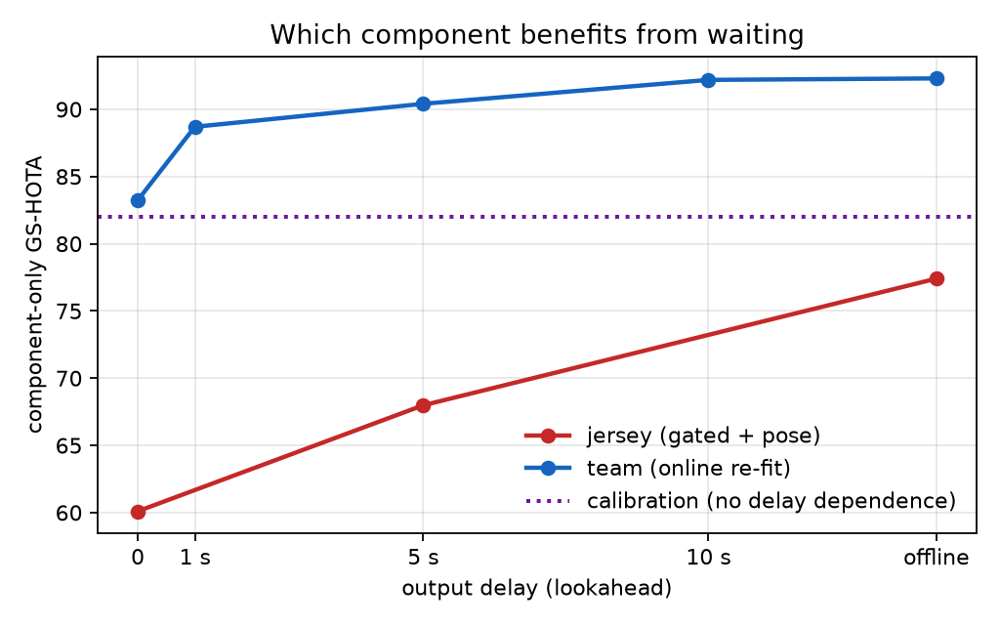
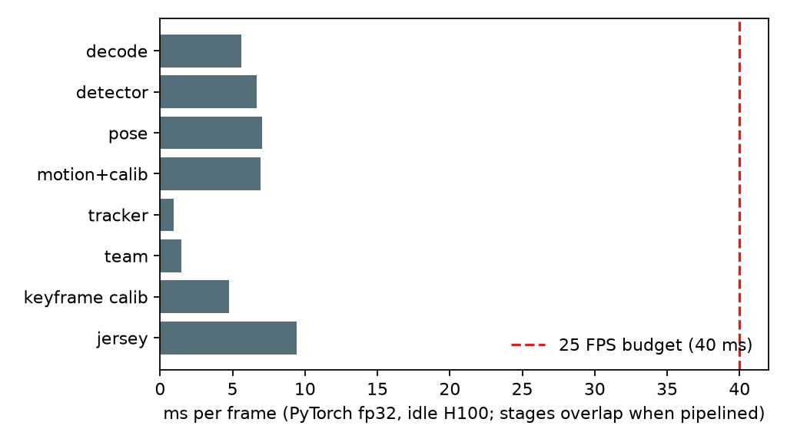

# Live Game State Reconstruction from a Single Broadcast Feed: What Waiting Buys You

*Technical report, draft, October 2026. All numbers are generated from raw results by
`scripts/make_report.py` into [`docs/report/data.json`](report/data.json) and
[`docs/report/tables.md`](report/tables.md).*

## Abstract

Game State Reconstruction (GSR) turns a single moving broadcast feed into a top-down
minimap: every player's position on the pitch, identity, team, role and jersey number.
Published GSR systems are offline. They cluster teams over the whole clip, read jersey
numbers anywhere in a track and paint them back over it, and merge tracklets after the
fact, and they report accuracy without speed. We build a complete GSR pipeline in which
every decision is causal, evaluate it as a live system, and measure how accuracy depends
on the one knob a live system controls: how long it may wait before committing an output
(the output delay). On the 49 labelled SoccerNet-GSR test clips the system reaches
**34.6 GS-HOTA with no lookahead and 43.6 with the whole clip**, rising steadily in
between (37.1 at 1 s, 39.9 at 5 s, 42.1 at 10 s); every step of delay is a significant gain under a
paired clip-level bootstrap (1 s: +2.5, 95% CI [+2.1, +2.9]). The full pipeline sustains
**32 FPS on one H100** (above the 25 FPS broadcast rate) at 56 ms median processing
latency. Component curves show that delay matters very unequally: jersey recognition
gains about 17 GS-HOTA points from waiting, team assignment about 9, and pitch
calibration none. An error budget and oracle swaps locate the remaining gap, and we
report several improvements that did not help, including a fine-tuned jersey reader whose
crop accuracy rose from 81% to 91% with no gain in GS-HOTA.

## 1. Introduction

Professional tracking (TRACAB, Second Spectrum, Hawk-Eye) relies on calibrated
multi-camera rigs installed in stadiums. Broadcast-only tracking exists commercially
(SkillCorner) but its method is unpublished. Lower leagues, academies and women's
football have broadcast or single-camera video and little else. The SoccerNet GSR task
[1] made the broadcast-to-minimap problem measurable, with a metric (GS-HOTA) that only
credits a predicted player if its pitch position and all of its attributes (role, team,
jersey number) are right.

The strongest GSR systems [2, 3, 4] are built for the leaderboard: they are offline by
design. The 2024 winner runs its raw tracking stage in real time with TensorRT, but its
team clustering and tracklet split/merge are offline post-processing, and only offline
GS-HOTA is reported [2]. A live product cannot look at the whole clip. It can, however,
delay its output by a bounded amount, as broadcast graphics already do. The question this
report answers is how much accuracy each second of delay buys, and where.

**Contributions.**

1. A complete causal GSR pipeline: detector with roles, tracker with camera-motion
   compensation, keyframe pitch calibration with optical-flow propagation, online team
   clustering, and delayed-commit jersey voting, evaluated with the official GS-HOTA.
2. GS-HOTA as a function of output delay, end to end and per component, on the
   SoccerNet-GSR valid and test splits.
3. A measured real-time operating point: 32 FPS sustained on one H100 with every stage
   running, and a per-stage latency budget.
4. An error budget, oracle analysis and a set of negative results that explain where the
   remaining accuracy is lost.

## 2. Related work

- **SoccerNet GSR** [1] introduced the task, the dataset (200 clips of 30 s, 1080p) and
  GS-HOTA. Its baseline runs offline at about 1.1 FPS on an A100.
- **Constructor.Tech (2024 winner, 63.81)** [2]: YOLOv5m, SegFormer calibration and
  DeepSORT in pitch coordinates. The raw tracking stage runs at up to 80 FPS (TensorRT
  FP16, DeepStream) with a 15-frame calibration smoothing delay, but team clustering and
  tracklet post-processing are offline and no online GS-HOTA is reported.
- **2025 challenge** [3]: the top entries (63.90, 63.81, 62.76, 61.64) use vision-language
  models for jersey and role, whole-clip split/merge, or both. No speed is reported.
- **Broadcast2Pitch** [4] (WACV 2026, 2025 challenge winner): keypoint and line calibration,
  appearance re-identification and vision-language-guided tracklet refinement. Neither the
  paper's abstract nor its public code report runtime or online operation; the code runs as
  sequential scripts, with tracklet refinement as a separate step on saved tracking results.
  We could not access the full text of its depth-aware extension (Broadcast2Pitch++) to check.
- **Building blocks** used here: PnLCalib for camera calibration [5]; the jersey
  recognition framework of Koshkina and Elder (legibility classifier plus PARSeq) [6, 7];
  ByteTrack-family trackers from the open-source `trackers` library, including McByte and
  BoT-SORT with camera-motion compensation [8]; TrackEval and SoccerNet's `sn-trackeval`
  for evaluation [9].

To our knowledge no prior work reports GSR accuracy as a function of output delay, or
evaluates every GSR decision causally.

## 3. Task and evaluation

**Data.** SoccerNet-GSR 2025 [1]: 57 train, 58 valid and 49 test clips with public labels
(30 s each, 25 fps, 1080p). The challenge split's labels are hidden, so the numbers here
are on the public test split and are *not* directly comparable to the challenge
leaderboard. All design choices were made on valid; test was run once per configuration
with frozen settings.

**Metric.** GS-HOTA [1] is HOTA in which predictions match ground truth by pitch distance
(Gaussian similarity, 5 m tolerance), and a match counts only if role, team and jersey
also agree. We report it with the official SoccerNet `sn-trackeval` code (the summary
table TrackLab reports as GS-HOTA). We also report *pitch HOTA*, the same matching with
attributes ignored, which isolates localization and tracking.

**Output delay.** A system with delay L may use frames up to t + L before emitting its
output for frame t. L = 0 is fully live, L = ∞ (the whole clip) is the offline setting.
Delays are reported in seconds at 25 fps (L = 25, 125, 250 frames is 1, 5, 10 s). The
real wall-clock delay is L plus the processing latency (56 ms median, Section 5.5).

## 4. System

| Stage | Method | Causal mechanism |
|---|---|---|
| Detection | YOLO26s fine-tuned on GSR train at 1280 px, 4 classes (player, goalkeeper, referee, ball) | per frame |
| Camera motion | sparse optical flow on a 640 px grey frame; one homography (for calibration) and one similarity (for the tracker) per frame | previous frame only |
| Tracking | McByte (ByteTrack family) fed the shared camera motion as compensation | online |
| Pitch calibration | PnLCalib [5] on every 10th frame, run asynchronously; between keyframes the image-to-pitch homography is carried forward with the frame-to-frame motion; a late keyframe result is brought up to date by chaining stored motions | keyframes in the past only |
| Identity repair | pitch-space stitching (re-link a new track to a recently lost one reachable at running speed, same role group, similar kit colour) and (team, jersey) linking | online |
| Role | majority detector class over the last second of the track and up to t + L | bounded window |
| Team | torso colour (Lab mean/std of non-grass pixels), 2-cluster k-means re-fitted every second on all evidence up to t + L; side from mean pitch x | evidence up to t + L |
| Jersey | legibility classifier plus SoccerNet PARSeq [6, 7] on pose-guided shoulder-to-hip crops; a read counts only if its top number has probability ≥ 0.97; per-track evidence accumulated up to t + L, committed once it passes a threshold | evidence up to t + L |

Detection, pose, the calibrator and the jersey reader run on the GPU; motion, tracking,
team features and decisions run on the CPU. The live runner overlaps them in threads.

## 5. Results

### 5.1 Error budget

Starting from perfect ground truth and degrading one factor at a time (valid):

| Degradation | GS-HOTA |
|---|---|
| none | 100.0 |
| team sides swapped / no team | 22.1 / 21.5 |
| no jersey numbers | 36.7 |
| pitch noise 0.5 m / 1 m / 2 m | 94.3 / 75.5 / 39.3 |
| per-frame calibration offset 1 m / 2 m / 4 m | 75.6 / 39.4 / 12.1 |
| track IDs broken every 10 s / 2 s | 63.4 / 30.5 |
| referees and goalkeepers labelled player | 88.2 |
| 10% of detections missed | 90.0 |

Because GS-HOTA requires every attribute to match, team side and jersey numbers dominate,
and calibration must be well under a metre. Missed detections and role confusion are
comparatively cheap.

### 5.2 Which components benefit from waiting

Component-only GS-HOTA on valid, with every other attribute taken from ground truth:

| Component | 0 | 1 s | 5 s | 10 s | offline |
|---|---|---|---|---|---|
| jersey (gated, pose crops) | 60.1 | - | 68.0 | - | 77.4 |
| team (online re-fit) | 83.2 | 88.7 | 90.4 | 92.2 | 92.3 |
| calibration (keyframe every 10) | 82.0 | 82.0 | 82.0 | 82.0 | 82.0 |

Jersey numbers are legible only now and then, so evidence keeps arriving for many seconds
and the curve keeps rising to the offline end (+17.3). Team colour saturates within about
10 s (+9.1). Calibration has no delay dependence in our design. Keyframe calibration with
propagation keeps 99% of per-frame accuracy (82.0 vs 82.5 calibration-only GS-HOTA,
0.57 m vs 0.53 m median error) while calling the calibrator on 9.8% of frames.
Propagation alone, without fresh keyframes, drifts to 4.9 m median error (29.4).

### 5.3 End-to-end accuracy vs output delay

Valid (58 clips), cumulative ablation:

| Configuration | 0 | 1 s | 5 s | 10 s | offline | pitch HOTA |
|---|---|---|---|---|---|---|
| ByteTrack, colour team, raw PARSeq jersey | 26.4 | 28.1 | 30.3 | 31.1 | 32.2 | 63.4 |
| + McByte with shared camera-motion compensation | 26.5 | 28.3 | 30.5 | 31.2 | 32.0 | 64.1 |
| + jersey evidence gating | 27.8 | 29.8 | 32.4 | 34.0 | 35.2 | 64.1 |
| + pitch-space stitching | 28.7 | 30.5 | 33.0 | 34.6 | 36.2 | 66.2 |
| + (team, jersey) identity linking | 28.7 | 30.5 | 33.1 | 34.7 | 36.4 | 65.8 |
| **+ pose-guided jersey crops (final)** | **29.5** | **31.6** | **34.3** | **35.9** | **37.9** | **66.0** |

Paired clip bootstrap of each step on valid (live / offline, 95% CI): camera-motion
compensation +0.1 [-0.4, +0.6] / -0.2 [-1.4, +0.8] (not significant); gating
+1.4 [+0.8, +2.0] / +3.3 [+2.3, +4.4]; stitching +0.9 [+0.2, +1.6] / +0.9 [-0.8, +2.7];
number linking 0.0 [-0.2, +0.2] / +0.2 [+0.0, +0.4]; pose crops +0.9 [+0.5, +1.3] /
+1.5 [+0.9, +2.2]. First version to final: +3.2 [+1.9, +4.5] live and +5.7 [+3.2, +8.1]
offline.

Test (49 clips), final configuration, settings frozen from valid:

| Configuration | 0 | 1 s | 5 s | 10 s | offline | pitch HOTA |
|---|---|---|---|---|---|---|
| **final** | **34.6** | **37.1** | **39.9** | **42.1** | **43.6** | **66.1** |
| 95% CI (clip bootstrap) | 31.3-37.8 | 33.7-40.6 | 36.0-43.8 | 38.0-46.3 | 39.3-47.8 | |

Confidence intervals come from resampling the 49 test clips 2,000 times and recombining
them with TrackEval's own pooling, so each resample is an exact GS-HOTA
(`scripts/gsr_bootstrap.py`). The absolute intervals are wide (about ±3 to ±4 points)
because clips differ a lot in difficulty. Paired differences on the same resampled clips
are much tighter: delay gains +2.5 [+2.1, +2.9] at 1 s, +5.3 [+4.0, +6.8] at 5 s and
+9.0 [+5.6, +12.4] offline over live, all with P(gain ≤ 0) < 0.001.

The live-to-offline gap is 9.0 points on test and 8.4 on valid. The first second of
delay recovers 28% of that gap on test, and 10 s recovers 84%. Pitch HOTA is the same on
both splits (66.1 vs 66.0), so the higher test score comes from the attributes. We have
not analysed which test clips drive the difference.

For reference, the SoccerNet baseline scores about 29 offline [1] and the offline
challenge winners about 64 [2, 3], both on the hidden challenge split, so neither is a
like-for-like comparison.

### 5.4 Where the remaining points are

Oracle swaps replace one attribute of our live predictions with the ground truth of the
matched box (valid, earlier ByteTrack configuration at 26.4 live):

| Ground truth swapped in for | live | offline |
|---|---|---|
| nothing (prediction) | 26.4 | 32.2 |
| role | 27.9 | 33.6 |
| team | 30.8 | 35.0 |
| jersey | 39.0 | 44.1 |
| team + jersey | 50.2 | 50.2 |
| all attributes | 60.5 | 60.6 |
| pitch position | 30.3 | 37.1 |
| pitch position + all attributes | 72.0 | 72.1 |

Jersey numbers are the largest single lever (+12.7 live). With current tracks, perfect
attributes and positions cap GS-HOTA at 72, so identity fragmentation costs the rest: each
real player is split into 2.85 predicted tracks on average, and 75% of the breaks are
frame-to-frame ID changes while the player stays visible, not players leaving the frame.

### 5.5 Speed

Per-stage latency on an idle H100 NVL, one clip, PyTorch fp32 (median per frame):

| Stage | ms |
|---|---|
| decode | 5.6 |
| detector (1280 px) | 6.6 (TensorRT FP16: 5.0) |
| pose (1280 px) | 7.0 (TensorRT FP16: 5.1) |
| camera motion + calibration propagation (CPU) | 6.9 |
| tracker (CPU) | 1.0 |
| team features (CPU) | 1.5 |
| keyframe calibrator | 47.7 per call, 4.8 amortised (every 10th frame) |
| jersey (legibility + PARSeq, about 13 crops/frame) | 9.4 |

Measured sustained throughput with stages overlapped (`scripts/live_runner.py`, TensorRT
FP16 detector and pose, asynchronous calibrator):

| Configuration | sustained FPS | latency p50 / p95 |
|---|---|---|
| without jersey reading | 44.2 | 44 / 58 ms |
| **full pipeline, jersey reader on the same GPU** | **32.0** | **56 / 64 ms** |

The jersey reader runs as a second process because its dependencies pin an older PyTorch,
so the 32 FPS is two processes sharing one GPU. Under that contention the jersey
process's own p95 rises to 124 ms per frame.

### 5.6 What did not help

- **Better image-space tracking.** On SoccerNet-GSR, McByte with camera-motion
  compensation cuts ID switches by 42% versus ByteTrack (2,015 vs 3,462; HOTA 0.596 vs
  0.584). End to end it moves GS-HOTA by +0.1 to +0.7, because attributes dominate.
  Reusing the calibration optical flow as the tracker's compensation matches the
  tracker's own estimator (0.596 vs 0.597 HOTA) at less than half the CPU cost.
- **A fine-tuned jersey reader.** Fine-tuning PARSeq on 72k weakly labelled legible GSR
  crops raised exact accuracy on held-out legible crops from 81.0% to 90.6%, but test
  GS-HOTA stayed flat (34.7 live, 43.0 offline vs 34.6, 43.6; paired differences +0.1
  [-0.4, +0.8] and -0.6 [-1.7, +0.3]). The remaining jersey loss
  is coverage (numbers never legible) and identity loss across track breaks, not misreads.
- **A small two-digit jersey classifier** trained on tracklet labels learned kit
  appearance rather than digits (11% track accuracy).
- **Other jersey crops.** Wider, lower and whole-box crops all read worse than the torso
  band; pose-guided shoulder-to-hip crops read best.
- **Pitch-space stitching on its own** improves pitch HOTA (63.4 to 64.9) but not
  GS-HOTA until jersey evidence is trustworthy enough to use with it.

On SportsMOT (an image-space MOT benchmark used for the early tracker work), fine-tuning
the detector raised HOTA from 0.431 to 0.558, and switching to the `trackers` library's
ByteTrack on the same detections raised it to 0.645. The boxmot ByteTrack used initially
was the bottleneck, not its thresholds.

## 6. Limitations

- Confidence intervals cover clip sampling only; each configuration was trained and run
  once, so run-to-run variance (detector training seed, tracker nondeterminism) is not
  included.
- Public test split, not the hidden challenge split; no like-for-like comparison with
  leaderboard entries.
- Speed is measured on one clip and one GPU type, with the jersey reader as a separate
  process.
- The offline numbers are this system given the whole clip, not an offline-optimised
  system: the gap to the challenge winners (about 64) remains large.
- The detector and jersey reader are trained only on SoccerNet broadcast footage. No
  evaluation on other leagues, camera setups or amateur video yet.

## 7. Licensing and reproducibility

The PnLCalib weights (GPL-2.0) and the SoccerNet jersey legibility and PARSeq weights
(non-commercial) are used for research measurement only. A commercial version would need
those components retrained from permissively licensed starting points. Ultralytics YOLO
is AGPL-3.0. All experiment scripts are in `scripts/`, the commands are in the README,
and `scripts/make_report.py` regenerates every table and figure in this report from
`results/`.

## References

1. Somers et al., *SoccerNet Game State Reconstruction: End-to-End Athlete Tracking and
   Identification on a Minimap*, CVPR Workshops 2024. arXiv:2404.11335.
2. Golovkin et al., *From Broadcast to Minimap: Achieving State-of-the-Art SoccerNet Game
   State Reconstruction*, CVPR Workshops 2025. arXiv:2504.06357.
3. *SoccerNet 2025 Challenges Results*, arXiv:2508.19182.
4. Oo et al., *Broadcast2Pitch: Game State Reconstruction from Unconstrained Soccer
   Videos*, WACV 2026.
5. Gutiérrez-Pérez and Agudo, *PnLCalib: Sports Field Registration via Points and Lines
   Optimization*, arXiv:2404.08401.
6. Koshkina and Elder, *A General Framework for Jersey Number Recognition in Sports
   Video*, CVPR Workshops 2024. arXiv:2405.13896.
7. Bautista and Atienza, *Scene Text Recognition with Permuted Autoregressive Sequence
   Models* (PARSeq), ECCV 2022.
8. Roboflow `trackers` library (ByteTrack, BoT-SORT, McByte implementations),
   github.com/roboflow/trackers.
9. Luiten et al., TrackEval; SoccerNet `sn-trackeval`, github.com/SoccerNet/sn-trackeval.
